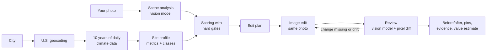

# EcoReno AI

Pick a real house (search free-licensed photos, choose a sample home, or upload your own), pick any U.S. city, and EcoReno edits that same photo with exterior upgrades suited to the city's climate. Every change on the image links back to the ten years of weather data that justified it, and the app checks its own edit before showing it to you.

Built solo for Banana Hacks 2026 (image AI track). Live demo: _link added at deployment_.

<!-- Screenshot / GIF of the before-after slider goes here once the Gemini key is live. -->

## Why this exists

Renovation inspiration ignores climate. A drought-tolerant yard makes sense in Irvine, California, where plants need about 36 more inches of water a year than falls as rain. It makes no sense in Minneapolis, where rain covers demand and the bigger problem is 149 freezing nights a year. Advice that says "use native plants" doesn't show a homeowner what that would look like on their own house, and pictures on Pinterest aren't their house.

EcoReno is for a homeowner (or a renter, or someone looking at a listing) who wants to see a climate-appropriate version of a real home before talking to a contractor. It is a concept tool. It doesn't survey the lot, check permits, or predict utility savings, and it says so on every result.

## How it works



The image model is the center of the product, but it only does one job. Everything that involves a number happens in ordinary code, so no model ever writes, rounds, or restates a climate figure.

1. A vision model looks at the photo first. It checks that it's a house exterior and reports which features are visible (lawn, roof, paving, windows, open yard, downspout, wall) with a confidence and an approximate location. Users can correct any of it. If the model is unavailable, users mark the features themselves.
2. City search uses the Open-Meteo geocoder, filtered to the 50 states and D.C. Duplicate names (Portland, OR vs. Portland, ME) are shown side by side and nothing is picked automatically.
3. The server pulls 2016–2025 daily data for the city's grid cell from the Open-Meteo historical archive and computes 15 metrics: precipitation, reference evapotranspiration (ET₀), water deficit, dry months, hot days (90 °F and up), freezing nights, heavy-rain days (an inch or more), heating and cooling degree days, solar radiation, snowfall and wind. Missing days are counted and flagged, never filled in.
4. Those metrics become standard classifications: Köppen climate type (using the definitions in Peel et al., 2007), the UNEP aridity index, an approximate USDA plant hardiness zone, and whether the climate is heating- or cooling-dominated. The profile, not the city name, decides what the edit looks like. Phoenix gets desert planting because its aridity index is 0.15 and its zone is 10a, not because it's Phoenix.
5. Nine possible upgrades are scored with a disclosed heuristic (40% climate evidence, 30% benefit, 20% visibility in the photo, 10% the user's priority). Hard gates run first: no lawn means no lawn replacement, and a heating-dominated climate never gets a reflective roof. The "Balanced" setting picks a mix of water, heat and stormwater measures only when the evidence supports more than one; it won't pad the list.
6. The selected upgrades become a structured edit plan: what to change, where, which regional style to use, what must stay untouched, and what's forbidden (repainting, new structures, turning grass into concrete, changing the sky). The prompt contains no numbers and no city name, which keeps the image model from reaching for stereotypes like rainy skies in Seattle.
7. The image model edits the original photo. The output is resized to the original's exact pixels. A second vision call reviews the result change by change and checks each preserved element. Independently, the browser computes a pixel-difference map that uses no model at all, reporting how much of the photo changed and how much changed outside the targeted areas. If a change is missing or something drifted, the pipeline retries once with a stricter prompt and keeps the better attempt. If problems remain, they're listed on screen.

Comparing cities reuses the same photo and features. On the recorded data, Irvine's balanced picks are native planting, rooftop solar and window awnings; Minneapolis gets an evergreen windbreak, a rain garden and a rain barrel. Those differences come from the numbers, and when two cities' numbers agree, the app says so instead of inventing a contrast.

## Home value

The value panel uses official data and a model we fit ourselves. The city's center point is matched to its Census microdata area, and the app trains a survey-weighted regression of log home value (bedrooms, age, attached or detached, lot size) on owner-occupied one-family homes from the American Community Survey 2020–2024 five-year microdata. It shows the number of homes, the R², the typical error and an 80% range, next to the Census Bureau's own published median for the city.

Upgrade premiums only come from published studies. Rooftop solar uses the Lawrence Berkeley National Laboratory's *Selling into the Sun* (about $4 per watt, $2.60 to $5.90 depending on system age). Street trees (USDA Forest Service, Portland) and landscaping quality (Henry 1994) are shown as related evidence but not added, because they measured something different. Everything else is labeled as having no reliable estimate. Census values are owners' own estimates, the figures are in 2024 dollars, and none of this is an appraisal.

## Measured fidelity

_Pending: runs as soon as the image model is connected._ The table will report, for five photos and two edit plans each: the share of requested changes the reviewer saw, the share of pixels changed outside the targeted areas, retries needed, and time per edit.

## What it won't tell you

Climate values describe a reanalysis grid cell near the city center (roughly 10 to 25 km), not your lot, and the approximate plant zone can run warm where cold snaps are sharp (Anchorage computes as 6a; the USDA map says about 4b to 5a). Heavy-rain days are rainfall context, not flood risk. Solar panels on the image are illustrative and say nothing about your roof's orientation or shading. Feature detection is a guess, which is why you can correct it.

## Run it locally

Requires Node 20+.

```bash
npm install
cp .env.example .env.local   # then add your keys
npm run dev                  # http://localhost:3000
```

| Variable | Needed for |
|---|---|
| `GEMINI_API_KEY` | Photo analysis, image edits, and review ([Google AI Studio](https://aistudio.google.com/apikey)) |
| `CENSUS_API_KEY` | The home-value panel ([free signup](https://api.census.gov/data/key_signup.html)) |
| `UNSPLASH_ACCESS_KEY` | Live house-photo search ([free developer app](https://unsplash.com/developers)) |
| `UPSTASH_REDIS_REST_URL`, `UPSTASH_REDIS_REST_TOKEN` | Shared cache and rate limits in production (optional locally) |

City search and climate data need no keys.

```bash
npm test                       # 130 unit tests, incl. real recorded data for 9 cities
npm run typecheck
npx tsx scripts/profile-report.ts      # climate classes for every recorded city
npx tsx scripts/engine-report.ts       # ranked upgrades per city
npx tsx --conditions=react-server scripts/spike-edit.mts photos/house.jpg   # one-off edit test
```

## Project layout

| Path | What's there |
|---|---|
| `lib/openMeteo.ts`, `lib/climateMetrics.ts`, `lib/siteProfile.ts` | Climate fetch, metrics and classifications |
| `lib/interventions.ts`, `lib/recommendationEngine.ts`, `lib/regionalStyle.ts` | Upgrade catalog, gates, scoring, regional styles |
| `lib/editPlan.ts`, `lib/renovationPrompt.ts` | Edit plan and the prompt sent to the image model |
| `lib/imageEditClient.ts`, `lib/visionClient.ts`, `lib/generatePipeline.ts` | Gemini adapters, review, retry |
| `lib/changeMap.ts` | Model-free pixel comparison |
| `lib/census.ts`, `lib/valueModel.ts`, `lib/premiums.ts` | Home-value data, regression, cited premiums |
| `app/api/*` | Route handlers (geocode, climate, analyze-photo, generate, home-value) |
| `tests/` | Vitest suites and recorded fixtures |

## Data, licenses and credits

Weather data: [Open-Meteo](https://open-meteo.com/) Historical Weather API (CC BY 4.0), built on ERA5 and ERA5-Land reanalysis from the Copernicus Climate Change Service. Geography and housing data: U.S. Census Bureau (Geocoder, ACS PUMS, table B25077). Value studies: [Lawrence Berkeley National Laboratory](https://newscenter.lbl.gov/?p=33444), [USDA Forest Service](https://fs.usda.gov/pnw/sciencef/scifi126.pdf), [Henry 1994](https://jeh.kglmeridian.com/view/journals/jenh/12/2/article-p65.xml). Next-step links point to EPA WaterSense, EPA Soak Up the Rain, DOE and DSIRE. House photos for search and the sample gallery come from [Unsplash](https://unsplash.com/?utm_source=ecoreno_ai&utm_medium=referral) under the Unsplash License, credited to each photographer in the app. Listing sites like Zillow aren't used: they offer no public API, scraping breaks their terms, and listing photos are copyrighted.

## License

The code is MIT-licensed (see `LICENSE`). Third-party content keeps its own terms: the sample house photos in `public/samples/` are from Unsplash under the Unsplash License, and the recorded weather data in `tests/fixtures/` comes from Open-Meteo under CC BY 4.0.

## How this was built

I built EcoReno during the Banana Hacks 2026 event window (Oct 9–11) with Claude Code (Anthropic) as my coding assistant for planning, code, tests and review. Image editing, photo analysis and review run on Google Gemini. The planning documents (`PLAN.md`, `CLAUDE.md`, `PROGRESS.md`) and a session log (`docs/SESSION_LOG.md`) are in the repo as they were used.
